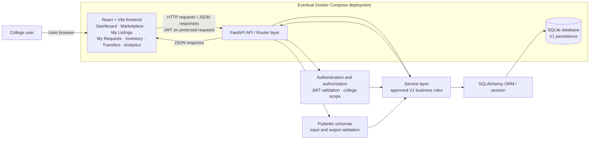

# CampusCycle V1 System Architecture

**Status:** Phase 2 design proposal — Task 1 (System Architecture Design)  
**Scope:** Architecture only. This document does not define the database schema, API endpoint inventory, or detailed business rules, and it does not implement backend functionality.

## 1. Project overview and architectural goals

CampusCycle is an inter-college resource-sharing and redistribution platform. Its V1 scope covers college registration and authentication; college and user management; resource listings and marketplace; donations, exchanges, and purchase enquiries; requests and approval/rejection; inventory and reservations; inter-college transfers, tracking, and receipt confirmation; and dashboard and analytics. Purchase payments remain outside the application.

The design follows the agreed V1 stack: React and Vite, Python and FastAPI, SQLAlchemy, Pydantic, SQLite, JWT authentication, and Docker Compose for eventual deployment.

Architectural goals:

- Keep presentation, HTTP/API handling, business rules, persistence, and validation responsibilities separate.
- Enforce authentication, authorization, and college-level data isolation in the backend.
- Keep resource availability, reservations, request outcomes, and transfer records consistent.
- Make the frontend/backend boundary explicit through HTTP and JSON contracts.
- Keep local development straightforward and make deployment reproducible later with Docker Compose.
- Keep the system within approved V1 scope; avoid unapproved modules and external payment processing.

## 2. High-level system architecture

The browser runs the React frontend. The frontend communicates with a FastAPI application over HTTP using JSON. FastAPI validates input with Pydantic schemas, authenticates and authorizes protected operations, and delegates business rules to service modules. Services use SQLAlchemy to read and write SQLite data. Responses return through the API layer as JSON. The browser never connects directly to SQLite.

The design is a single frontend application and a single backend application backed by one SQLite database for V1. The backend may be organized into focused modules without requiring separate deployable services. No chat, recommendation, payment-gateway, rental, temporary-borrowing, or return service is part of this architecture.

## 3. Frontend architecture and existing modules

The existing frontend is a React + Vite JavaScript application using Tailwind CSS v4 and Lucide React. `frontend/src/main.jsx` mounts `App`; the current application shell and modules are primarily in `frontend/src/App.jsx`. Navigation switches the active view in React state; the current package manifest does not include a routing library or API client library. The frontend is currently a prototype that uses demonstration data and local state, including local storage for theme preference. It is not yet connected to an API or persistent application database.

Existing V1 modules and their architectural roles:

- **Dashboard:** summary view and navigation into resource, request, transfer, and analytics areas.
- **Marketplace:** discover and search resource listings, then begin the relevant request or enquiry flow.
- **My Listings:** create and manage a user's or college's resource listings.
- **My Requests:** display sent and received requests and present approval/rejection actions for eligible requests.
- **Inventory:** show resource quantities and reservations.
- **Transfers:** show transfer status and receipt confirmation controls.
- **Analytics:** present sharing, request, inventory, and transfer measurements.

These describe the prototype's modules, not finalized permissions or business rules. The frontend remains the presentation layer: it may collect user input and display server results, but backend authorization and validation remain authoritative. Preserve the completed frontend; integration can be introduced in the later roadmap phase without rewriting it.

## 4. Backend architecture and responsibilities

The proposed backend is one FastAPI application organized into the following logical layers.

### API/router layer

- Expose HTTP routes grouped by V1 resource areas (for example, authentication, colleges/users, listings, requests, inventory, transfers, and analytics).
- Parse path, query, and body inputs and declare response schemas/status codes.
- Apply authentication and authorization dependencies to protected operations.
- Call service functions and translate expected outcomes into HTTP responses.
- Avoid placing multi-step business rules or direct persistence logic in route handlers.

The concrete endpoint list is a later Phase 2 deliverable and is intentionally not specified here.

### Service/business logic layer

- Coordinate use cases across validation, authorization context, and persistence.
- Apply approved rules for listing changes, request decisions, inventory reservations, transfer tracking, receipt confirmation, and analytics.
- Keep operations that must succeed or fail together within an appropriate database transaction.
- Avoid embedding business behavior in React components or ORM model methods.

No unresolved workflow rule is decided by this document. Services should encode only rules approved during design.

### Database/model layer

- Define SQLAlchemy ORM mappings after the separate database-design task.
- Manage SQLAlchemy engine, session creation, transaction boundaries, and persistence access.
- Use SQLite for V1 as agreed.
- Apply constraints and indexes from the approved schema design; do not rely on frontend checks for data integrity.

This task creates no models, database tables, migrations, or database code.

### Schema/validation layer

- Define Pydantic schemas for request input and response output.
- Validate types, required fields, lengths, formats, and allowed values at the HTTP boundary where those rules are known.
- Keep API schemas separate from SQLAlchemy persistence models so API contracts can evolve deliberately.
- Return field-level validation errors without exposing internal exception details.

### Authentication and authorization layer

- Authenticate credentials through dedicated authentication services and issue JWT access credentials after successful authentication.
- Validate credentials on protected requests and construct a trusted request identity for downstream authorization.
- Enforce role/permission checks and college ownership/scope on the backend.
- Keep password hashing, token signing configuration, and sensitive operations server-side.

Token lifetime, refresh behavior, credential storage on the client, college onboarding/verification, and the exact roles and permissions require confirmation before implementation.

## 5. Database communication through SQLAlchemy

FastAPI route/service code uses a SQLAlchemy session supplied through a controlled dependency or unit-of-work boundary. Services request reads and writes through SQLAlchemy ORM or parameterized SQLAlchemy statements; no browser code talks to SQLite and no request data is interpolated into raw SQL.

For write operations, transaction boundaries should encompass all related state changes. For example, a future approved request/reservation operation may need coordinated updates; the exact atomic changes and concurrency rules must be defined in the inventory/reservation design before implementation. Failed operations should roll back rather than leave partial records.

The SQLite database file should be outside the public/static frontend directory and excluded from version control. Local file location, backup policy, connection settings, and concurrency limits remain deployment/configuration decisions to document before production use. No schema is proposed here.

## 6. React–FastAPI communication over HTTP/JSON

The frontend sends HTTP requests to the FastAPI API and receives JSON responses. The frontend should use a single configurable API base URL, supplied through environment-specific frontend configuration, and a small shared request helper can centralize headers, JSON parsing, and error handling when integration begins. This is a proposal, not a request to add a client library now.

Requests with a JSON body use the appropriate content type. Protected requests carry the agreed JWT using the authentication transport selected during security design; a bearer authorization header is the proposed default, pending confirmation of token storage and browser threat mitigations. The frontend must not send or choose an authoritative college scope that the backend accepts without checking against the authenticated identity.

Request/response JSON contracts, endpoint paths, pagination, filtering, and API versioning are planned in the API-planning task. A consistent error response is proposed in Section 10.

## 7. High-level authentication flow

1. A user submits registration or login information through the frontend over HTTPS in deployed environments.
2. FastAPI validates the payload, applies the approved college/user onboarding rules, and verifies credentials using a secure password hash for login.
3. On successful authentication, the backend issues a signed JWT according to approved signing, lifetime, and claim rules. Sensitive signing keys come from environment-based secrets and are never committed.
4. The frontend retains and sends the credential using the approved storage/transport approach; exact storage is unresolved.
5. On protected requests, FastAPI validates the token's signature and validity, loads or derives the authenticated identity, then checks permissions and college scope before invoking the use case.
6. Invalid or missing credentials are rejected. Authorization is repeated on every protected operation; hiding a button in the frontend is not authorization.

This flow does not decide whether users can belong to multiple colleges, who may register or verify a college, or what roles exist. Those decisions require confirmation.

## 8. Main resource request and transfer workflow

The documented high-level workflow is **Listing → Request → Approval → Reservation → Dispatch → Receipt → Completion** (`README.md`). The following maps that flow to system components without adding policy:

1. A college/user creates or manages an eligible listing through the frontend and listings API; approved listing rules determine its visibility and availability.
2. A requester submits a request for a listing. The backend authenticates the actor, validates the request, and applies college-level access rules.
3. The authorized decision-maker reviews the request and approves or rejects it. A rejection must not proceed as an approved reservation/transfer. The authorized decision-maker and detailed state rules are not yet specified.
4. For an approved request, the backend applies the approved inventory reservation rules consistently. Whether approval and reservation are one atomic operation is an open design decision.
5. If the approved workflow requires movement between colleges, the transfer capability records and exposes its progress. Dispatch, tracking events, and responsible actors need confirmation.
6. Receipt confirmation is recorded by an authorized actor under the future agreed rules. The effect of confirmation on inventory and request completion must be decided in workflow design.
7. The dashboard and analytics read backend data and summarize approved measures; metric definitions and visibility must be specified before implementation.

Purchase enquiries remain enquiries. Payments are handled outside CampusCycle; this architecture includes no payment gateway or payment processing.

## 9. Proposed backend folder/module responsibilities

The following is a proposed organization for a future backend foundation. It is a design sketch only; no folders or source files are created by this task.

```text
backend/
  app/
    main.py                 # FastAPI application creation and router registration
    core/
      config.py             # Environment-based settings
      security.py           # Password hashing and JWT utilities
      errors.py             # Shared application error types/handlers
    api/
      deps.py               # Database session and authenticated-user dependencies
      router.py             # API router composition
      routes/
        auth.py             # Registration/login/current identity routes
        colleges.py         # College and user management routes
        listings.py         # Resource listing routes
        requests.py         # Request review/decision routes
        inventory.py        # Inventory and reservation routes
        transfers.py        # Transfer tracking/receipt routes
        analytics.py        # Dashboard and analytics routes
    schemas/                # Pydantic input/output contracts
    models/                 # SQLAlchemy ORM mappings (after schema approval)
    services/               # Use cases and business rules
    db/
      session.py            # Engine/session setup and lifecycle
      base.py               # Model metadata registration, if needed
    repositories/           # Optional persistence queries, only if useful
  tests/                    # Backend tests
```

The exact package layout is open to adjustment during Phase 3. Keep modules focused and avoid adding abstractions without a clear use.

## 10. Error handling and validation approach

- Validate request bodies, path values, and query parameters with Pydantic/FastAPI at the API boundary.
- Apply business validation in services for rules that depend on current state, permissions, or multiple records.
- Use appropriate HTTP status codes: for example, 400 for malformed/invalid operations, 401 for missing/invalid authentication, 403 for authenticated but unauthorized actions, 404 for unavailable or out-of-scope resources, 409 for state conflicts, 422 for schema validation, and 500 for unexpected server errors. Exact status mapping should be documented with the API contracts.
- Return a stable JSON error shape, proposed as:

```json
{
  "error": {
    "code": "validation_error",
    "message": "The request could not be processed.",
    "details": []
  }
}
```

- `code` is a stable machine-readable value; `message` is safe for display/logging; `details` may contain field-level validation information without secrets or internal implementation details.
- Handle expected domain conflicts explicitly. Log unexpected failures server-side with a correlation/request identifier, but do not return stack traces, credentials, tokens, or database internals to clients.
- Ensure database transactions roll back when a multi-step write fails.

The response shape and status mapping are proposals for API-contract review, not finalized contracts.

## 11. Security and college-level data isolation

- Enforce tenant/college data isolation on the backend for every read and write that is college-scoped.
- Derive the caller's college scope from the validated authenticated identity and approved membership rules. Treat client-provided college identifiers only as requested targets and authorize them against that identity; never trust them as proof of access.
- Apply authorization consistently in services/queries so alternate endpoints cannot bypass route-level checks.
- Use secure password hashing and signed JWTs; keep signing secrets and configuration outside source control.
- Require HTTPS in deployed environments. Do not log passwords, full tokens, or sensitive personal data.
- Restrict CORS to known frontend origins in deployed configuration; do not use permissive production settings.
- Keep the SQLite file inaccessible to the web server's static asset path and protect backups.
- Validate and constrain uploaded/externally supplied data if such input is approved later; no file upload feature is assumed here.

The ownership model, multi-college membership rules, role matrix, administrator privileges, and whether any analytics may aggregate across colleges are unresolved. Do not infer these from the prototype UI.

## 12. Local development and eventual Docker deployment

### Local development (proposed)

- Run the existing Vite frontend using its current local development setup.
- Run the future FastAPI application separately as a local process, configured with an API base URL and environment-based backend settings.
- Store the SQLite database at a backend-controlled local path, outside frontend static assets and excluded from Git.
- Configure local CORS for the known Vite development origin.
- Keep secrets in ignored local environment files; provide only non-secret placeholders in any future example configuration.

No backend setup or configuration is implemented by this architecture task.

### Eventual Docker Compose deployment (Phase 11)

The intended deployment is a frontend container serving the built React application, a FastAPI backend container, and a persistent host-managed volume for the SQLite database file. Compose provides service networking and environment configuration; the browser reaches the API through an explicitly configured public route or reverse proxy. SQLite is an embedded file database, not a separate database server/container. The exact routing, TLS termination, persistence path, backup approach, and health checks require deployment design.

This is a future deployment outline only. Do not create Dockerfiles, Compose files, backend code, or database files as part of Phase 2 Task 1.

## 13. Architecture diagram



## 14. Assumptions and decisions requiring confirmation

### Agreed decisions used by this proposal

- V1 uses React + Vite, Python + FastAPI, SQLAlchemy, Pydantic, SQLite, JWT, and Docker Compose for eventual deployment.
- Purchase payments happen outside CampusCycle.
- The frontend prototype and its seven modules are preserved.
- College-scoped data must be isolated and protected by backend authorization.

### Open decisions — do not implement by assumption

- College registration eligibility, verification, and initial administrator creation.
- User roles, permissions, and whether one user can belong to multiple colleges.
- JWT storage/transport in the browser, token lifetime, refresh/revocation, and signing-key rotation.
- Which users may create listings, submit requests, approve/reject requests, manage inventory, dispatch transfers, and confirm receipt.
- Listing ownership and visibility; inventory quantity semantics and when quantities become available.
- Whether approval and reservation are atomic; reservation expiration/release behavior; handling simultaneous requests for limited quantity.
- Exchange matching/acceptance rules and the information required for a purchase enquiry.
- Transfer status vocabulary, tracking event requirements, dispatch actor, receipt actor, and the state changes caused by receipt confirmation.
- How cross-college records are visible to each party and what data may appear in aggregate analytics.
- API versioning, pagination/filter conventions, error envelope, and idempotency expectations for retryable writes.
- SQLite backup/recovery and expected concurrency/scale limits for V1 deployment.

These decisions should be resolved in the appropriate Phase 2 workflow, API, or database design tasks before implementation. This document does not mark Phase 2 complete and does not authorize starting Phase 3.
