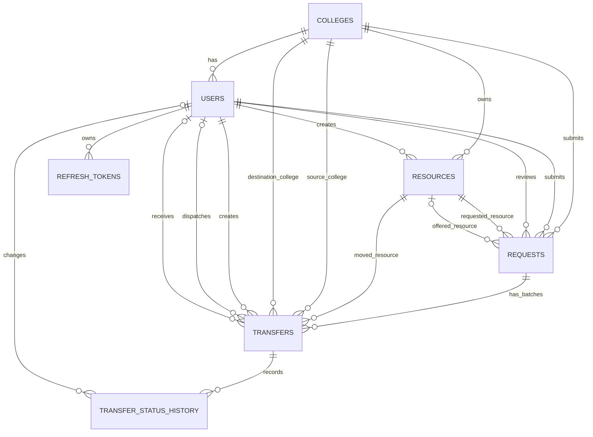

# CampusCycle V1 — Database Design

**Status:** Approved conceptual design  
**Database:** SQLite  
**ORM planned for later implementation:** SQLAlchemy  
**Scope:** Logical entities, relationships, inventory rules, and data integrity. This is design only; it does not create database code.

## 1. Core entities

The approved conceptual business model contains six core tables:

1. `colleges` — participating colleges and their verification state.
2. `users` — platform administrators and college representatives.
3. `resources` — resource listings and stock balances.
4. `requests` — donation, exchange, and purchase-enquiry requests.
5. `transfers` — one or more physical movement batches for a request.
6. `transfer_status_history` — audit trail for transfer status changes.

### Proposed supporting authentication table

A seventh table, `refresh_tokens`, is proposed because the approved authentication design includes refresh-token revocation at logout. A refresh token must be identifiable and revocable after it has been issued. Keeping only a self-contained JWT refresh token without a server-side record would not provide reliable per-token revocation.

**Approved:** The conceptual model contains seven tables. `refresh_tokens` is part of the approved V1 design.

## 2. Entity relationship diagram

`REFRESH_TOKENS` is the approved seventh supporting table for refresh-token persistence and revocation.

## 3. Relationship rules

- One college has many users, resources, and submitted requests.
- A user belongs to one college, except a platform administrator, whose `college_id` is null.
- A resource belongs to exactly one owning college and records the user who created it.
- A request identifies the requested resource and requesting college.
- An exchange request also identifies one offered resource and offered quantity.
- A request may have multiple transfer batches to support partial transfers.
- Each transfer batch moves one resource in one direction. Exchange requests use separate transfer legs for the requested resource and offered resource.
- A transfer has many status-history entries.
- A transfer may optionally be referenced by one or more replacement transfer batches, preserving the link between the disputed original batch and its approved replacement.
- A refresh token belongs to one user and one token family/session; rotation links each replaced token to its successor.

## 4. Request types and resource movement

`request_type`:
- `donation`
- `exchange`
- `purchase_enquiry`

For donation and purchase enquiry, `resource_id` identifies the listed resource being requested.

For exchange:
- `resource_id` identifies the resource requested from the other college.
- `offered_resource_id` identifies the one resource offered by the requesting college.
- `requested_quantity` and `offered_quantity` describe the two sides.
- Transfers use `transfer_leg = requested_resource` or `offered_resource`.
- The exchange request is not complete until both movement legs have been fulfilled and receipt/dispute resolution rules are satisfied.

Purchase payments are outside CampusCycle. The application records enquiries and confirmation of purchase intent; it does not process payments.

## 5. Inventory model

For each resource:

`quantity_total = quantity_available + quantity_reserved`

All quantities must be non-negative, and `quantity_reserved` cannot exceed `quantity_total`.

### Standard approved request

When a donation request is approved, reserve only the approved quantity, not the entire listing stock.

Example:
- Total stock: 100
- Approved request: 40
- Available: 60
- Reserved: 40

When a batch is dispatched, its quantity remains reserved. Dispatch alone does not reduce physical stock.

When a quantity is received in good condition and the receipt is accepted:
- reduce `quantity_total` by the accepted quantity;
- reduce `quantity_reserved` by the accepted quantity;
- `quantity_available` remains unchanged for that accepted quantity because it was already reserved.

Example after 25 of the 40 are received:
- Total: 75
- Available: 60
- Reserved: 15

After the remaining 15 are received:
- Total: 60
- Available: 60
- Reserved: 0

### Exchange reservation

On exchange approval, reserve both resource quantities in one atomic database transaction. If either side cannot be reserved, roll back the entire operation. Never leave only one side reserved.

### Purchase enquiry

Submitting or approving a purchase enquiry does not reserve stock. Reservation is attempted only when the buyer confirms purchase intent. If the requested quantity is no longer available:
- do not reserve any stock;
- do not automatically cancel the request;
- move the request to an awaiting-resolution state for a new decision between the colleges.

### Damaged or missing goods

The destination college may confirm the good quantity and report damaged/missing quantities as disputed. Disputed quantities must not be marked as successfully received or completed until an authorized resolution is recorded.

**Approved policy:** Platform Admin resolves disputes. Allowed outcomes are accepting the verified report/good quantity, approving a replacement transfer, or rejecting the claim after review. Disputed quantities remain held until physical status is verified and the resolution is recorded. Inventory is adjusted only according to the verified outcome; the backend applies the adjustment atomically and records the audit trail.

## 6. Transfer batching and completion

A request can have multiple transfer batches. For each movement leg, the sum of active/completed batch quantities must not exceed the approved quantity for that leg. The backend must enforce this under a transaction.

Example for an approved 100-chair movement:
- Batch 1: 40
- Batch 2: 35
- Batch 3: 25

A request is complete only when:
- all required quantities for the request have been moved;
- all required transfer batches are completed;
- receipt is confirmed;
- no unresolved disputed quantity remains.

For exchange, both movement legs must satisfy these conditions.

## 7. Cancellation

- Cancellation before dispatch may be reviewed and, when approved, release only the unshipped reserved quantity.
- If any batch has already been dispatched, cancellation of the remaining unshipped batches requires platform administrator review.
- If approved, only unshipped batches are cancelled and their reserved quantities are released.
- Already-dispatched batches continue through receipt and dispute resolution; they are not cancelled through this ordinary cancellation path.
- Inventory must not be adjusted for dispatched goods until their physical status is verified and the approved resolution is applied.

**Approved policy:** When no batch has been dispatched, an authorized representative of the resource-owning college reviews cancellation. If any batch has been dispatched, Platform Admin reviews cancellation of remaining unshipped batches.

## 8. College verification

| College verification status | Browse resources | Transact |
|---|---:|---:|
| `pending` | Yes | No |
| `verified` | Yes | Yes |
| `rejected` | Yes | No |

Rejected colleges may log in and browse resources, but cannot create or participate in transactions. Rejected colleges remain browse-only and cannot transact. This is separate from rejected resource requests; rejected requests remain rejected and require a new request for another attempt.

## 9. User and tenant boundaries

- College representatives are scoped to their own college.
- Authorized college representatives may create additional representative accounts for their own college only.
- They cannot create users for another college or create platform administrator accounts.
- A platform administrator is global and has no `college_id`.
- The backend derives college scope from the authenticated identity; it must not trust a client-supplied college ID as proof of authorization.
- Representatives may manage/deactivate representative accounts within their own college; the last active representative cannot be deactivated. Platform Admin may manage accounts across colleges.

## 10. Data integrity principles

- Use foreign keys and restrictive deletion behavior for transactional records.
- Prefer deactivation/status changes over deleting users, colleges, resources, requests, or transfers that have history.
- Use database CHECK constraints for simple row-level rules and service-layer validation for cross-table rules.
- Multi-record operations such as reservation, exchange approval, dispatch, receipt, and cancellation must run in transactions.
- Protect against concurrent over-reservation; a request must fail cleanly if stock changed before the transaction can reserve it.
